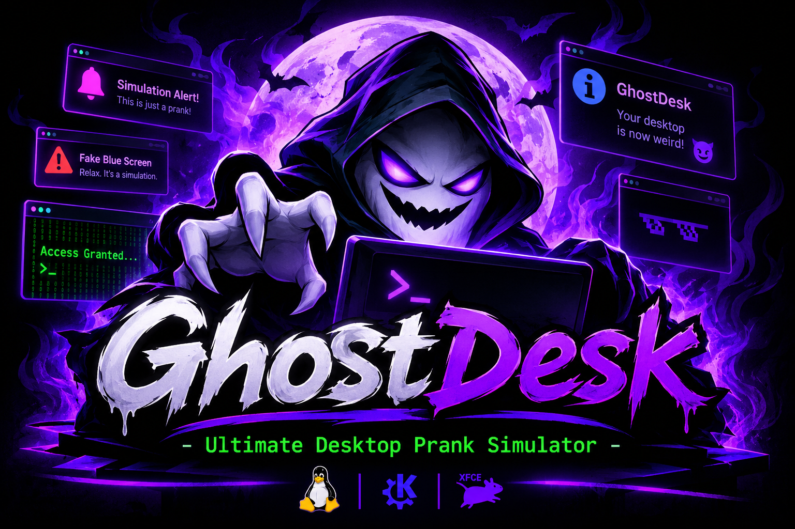

# 👻 GhostDesk — Ultimate Desktop Prank Simulator

<div align="center">



### Make Your Desktop Weird. Make It Fun. 😈

**A lightweight Bash-powered desktop prank simulator for Linux.**


</div>

---

## 🧠 About

**GhostDesk** is a fun, interactive desktop prank simulator written entirely in Bash.

It transforms an ordinary Linux desktop into a fictional hacker-style environment using strange notifications, animated terminal effects, simulated security alerts, and temporary desktop customization.

Designed for Linux users who enjoy terminal experiments, desktop customization, and harmless tech pranks.

GhostDesk is built around one simple idea:

> Your desktop doesn't have to be boring. 👻

## ✨ Features

| Feature | Description |
|---|---|
| 🟢 Matrix Terminal | Animated Matrix-style terminal effect |
| 💻 Hacker Terminal | Funny fictional hacking messages |
| 🔔 Notification Storm | Random desktop notifications |
| ⚠️ Simulation Alerts | Fake alerts clearly labeled SIMULATION |
| 🖥️ Fake Blue Screen | A harmless simulated crash message |
| 📊 System Monitor | Displays real CPU load and RAM information |
| 🖼️ Wallpaper Changer | Temporarily changes desktop wallpaper |
| ♻️ Wallpaper Restore | Attempts to restore the original wallpaper |
| 🎛️ Interactive Menu | Control effects through a terminal menu |

## 🖥️ Supported Desktop Environments

GhostDesk is designed for Linux desktop environments.

- KDE Plasma
- XFCE
- GNOME

Some desktop-specific features may require additional utilities or configuration.

## 📦 Requirements

- Linux operating system
- Bash
- Python 3
- libnotify
- A supported terminal emulator
- `procps`
- `zenity` or `kdialog` for graphical simulation dialogs

### Install dependencies

**Debian / Ubuntu / Kali Linux:**

```bash
sudo apt update

sudo apt install -y \
    bash \
    libnotify-bin \
    konsole \
    xfce4-terminal \
    zenity \
    kdialog \
    python3 \
    procps
```

## 🚀 Installation

Clone the repository:

```bash
git clone https://github.com/SilentSpectre-arch/GhostDesk.git
```

Enter the project directory:

```bash
cd GhostDesk
```

Give execution permission:

```bash
chmod +x ghostdesk.sh
```

## 🎮 Usage

Start GhostDesk:

```bash
./ghostdesk.sh
```

After launching, the interactive menu allows you to select your preferred prank effect.

### Menu Overview

```text
========== MAIN MENU ==========

1) Matrix Terminal
2) Fake Hacker Terminal
3) Notification Storm
4) Simulation Alerts
5) Fake Blue Screen
6) System Monitor
7) Change Wallpaper Temporarily
8) Restore Wallpaper
9) Run All Effects
0) Exit

Select an option:


## 🔒 Safety & Privacy

GhostDesk is designed as a local entertainment and educational project.

- Fake security alerts are explicitly marked as `SIMULATION`.
- No real hacking or unauthorized access is performed.
- No files are intentionally deleted or encrypted.
- No persistence or automatic startup is configured.
- Wallpaper changes are temporary and restoration is attempted when the script exits normally or receives an interrupt.
- System monitoring displays actual local system statistics.

**Important:** Wallpaper restoration depends on the desktop environment and its configuration. Save your original wallpaper settings before experimenting.


## 🤝 Contributing

Contributions, ideas, bug reports, and improvements are welcome!

If you find a bug or have an idea to improve GhostDesk, feel free to open an Issue or submit a Pull Request.

## 📜 License

This project is licensed under the MIT License.

See the `LICENSE` file for more information.

---

<div align="center">

### 👻 GhostDesk

**Not a real cyberattack. Just a little desktop chaos. 😂**

Made with ❤️ and Bash.

⭐ If you enjoy GhostDesk, consider giving the project a star!

</div>
